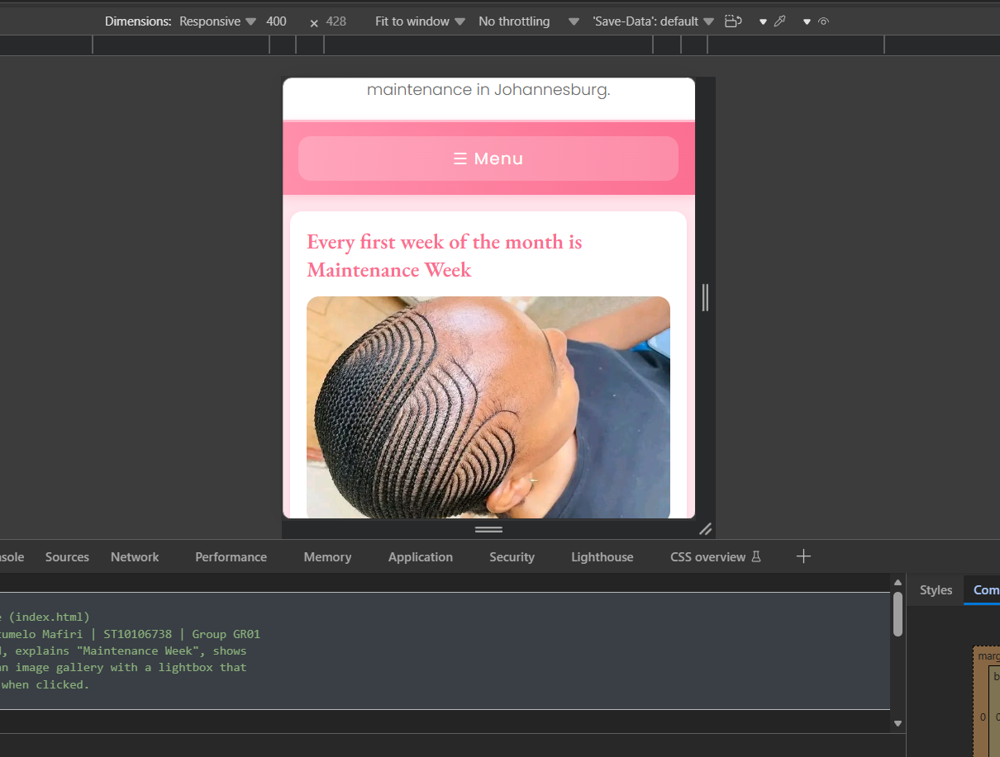

# Maintenance Essentials

**Find, compare and book your monthly beauty maintenance in Johannesburg.**

Live website: https://maintenance-essentials.netlify.app
Repository: https://github.com/BoitumeloMafiri/WEBDEVELOPMENT_PART2

---

## Student Information

|                    |                                         |
| ------------------ | --------------------------------------- |
| **Name**           | Boitumelo Mafiri                        |
| **Student Number** | ST10106738                              |
| **Module**         | Web Development (Introduction) WEDE5020 |
| **Group**          | GR01                                    |
| **Assessment**     | Portfolio of Evidence Part 3 (Final)    |
| **Institution**    | Rosebank College (The IIE)              |

---

## Project Overview

Maintenance Essentials is a beauty-maintenance discovery platform for young women in Johannesburg. Talented nail technicians, hair salons and lash artists are scattered across TikTok, Instagram and Google, which makes it hard to find someone you can trust. This website brings vetted providers together in one place, showing their real work, prices, estimated wait times and honest reviews.

The brand is built around **"Maintenance Week"**, the first week of every month set aside for nails, hair and lashes.

**Target audience:** young women aged roughly 18–35 in Johannesburg, plus beauty providers who want an online presence.

---

## Website Goals and Objectives

- Help clients find and book trusted, vetted beauty providers in their area.
- Give providers, especially those without a website, a credible online presence.
- Build trust through real portfolio photos, transparent pricing, wait times and honest ratings.
- Generate income through paid provider listings.

---

## Pages

| Page     | File            | Purpose                                                                  |
| -------- | --------------- | ------------------------------------------------------------------------ |
| Home     | `index.html`    | Maintenance Week intro, FAQ accordion, featured providers, image gallery |
| About    | `about.html`    | Brand story, mission, vision, vetting process                            |
| Services | `services.html` | Provider cards with live search and category filtering                   |
| Enquiry  | `enquiry.html`  | Booking form returning a price quote, plus provider listing form         |
| Contact  | `contact.html`  | Contact details, two branches, interactive map, email form               |

---

## Key Features and Functionality

### Part 3 — JavaScript functionality

- **FAQ accordion** questions expand and collapse on click, one at a time.
- **Gallery lightbox** any gallery image opens in a full-screen overlay; closes via the X, the background, or the Escape key.
- **Live provider search** results filter as you type, matching provider names, services and areas.
- **Category filtering** Nails / Hair / Lashes buttons narrow the list, working together with the search box.
- **Interactive map** buttons switch the embedded Google Map between the Braamfontein and Sandton branches.
- **Mobile navigation menu** a Menu button opens and closes the navigation on small screens.
- **Automatic footer year** the copyright year updates itself.

### Forms with JavaScript validation

- **Enquiry form**, validates name, surname, email format, 10-digit phone, service selection and date (rejecting past dates). On success it calculates and displays an estimated cost, the provider, the time in salon and the next Maintenance Week date.
- **Provider listing form**, validates business name, email and services offered.
- **Contact form**, validates all fields, then compiles the input into an email and opens the visitor's email program addressed to the organisation.

### SEO

- Unique, descriptive `<title>` tags on every page.
- `meta description` and `meta keywords` on every page.
- Descriptive image file names (e.g. `glossed-and-co-gel-nails.jpg`) and alt text on every image.
- Logical heading hierarchy (h1 → h2 → h3 → h4).
- Internal linking between all pages.
- `robots.txt` and `sitemap.xml` included.
- Mobile-friendly responsive design.

---

## Design

**Colour palette** (created using Coolors.co):

| Colour        | Hex       | Used for                          |
| ------------- | --------- | --------------------------------- |
| Lightest pink | `#FFE5EC` | Page background, card backgrounds |
| Light pink    | `#FFC2D1` | Borders and accents               |
| Mid pink      | `#FFB3C6` | Secondary accents                 |
| Pink          | `#FF8FAB` | Hover states, gradients           |
| Dark pink     | `#FB6F92` | Buttons, headings, navigation     |
| Charcoal      | `#2E2E2E` | Body text, footer                 |

**Typography:** EB Garamond (serif) for headings, Poppins (sans-serif) for body text.

---

## Responsive Design

| Screen  | Breakpoint      | Changes                                                   |
| ------- | --------------- | --------------------------------------------------------- |
| Desktop | Above 768px     | Three-column grid, full typography, horizontal navigation |
| Tablet  | 768px and below | Two-column grid, smaller headings, reduced image heights  |
| Mobile  | 480px and below | Single column, Menu button navigation, full-width buttons |

### Screenshots

**Desktop view**


**Tablet view**



**Mobile view**


---

## Technologies Used

- **HTML5** page structure and content
- **CSS3** styling, Flexbox and Grid layout, responsive media queries
- **JavaScript (ES6)** interactivity, form validation, dynamic content
- **Google Maps Embed** interactive location map
- **Git / GitHub** version control
- **Netlify** deployment
- **Visual Studio Code** code editor

---

## Folder Structure

```
ST10106738_Part3/
├── index.html
├── about.html
├── services.html
├── enquiry.html
├── contact.html
├── README.md
├── robots.txt
├── sitemap.xml
├── css/
│   └── style.css
├── js/
│   └── script.js
└── images/
```

---

## Timeline and Milestones

| Phase                                        | Dates                 | Status    |
| -------------------------------------------- | --------------------- | --------- |
| Part 1 — Planning, proposals, HTML structure | 6-21 August 2026      | Completed |
| Part 2 — CSS styling and responsive design   | September 2026        | Completed |
| Part 3 — JavaScript, SEO, forms, deployment  | October-November 2026 | Completed |

---

## How to View the Website

1. Visit the live site at https://maintenance-essentials.netlify.app
2. Or download this repository, open the folder in Visual Studio Code, right-click `index.html` and choose **Open with Live Server**.

---

## Changelog

All notable changes to this project are recorded here, most recent first.

### Part 3 — November 2026

**Corrections made based on Part 2 feedback**

- Reviewed all marking rubric criteria and addressed each outstanding item before final submission.
- Confirmed the external stylesheet is correctly linked in all five pages.
- Verified all pages deploy and load without errors.
- Ensured all commits are pushed with descriptive messages, after GitHub marks were lost in earlier parts.

**New work for Part 3 — JavaScript functionality**

- Created `js/script.js` and linked it to all five pages.
- Added an FAQ accordion on the home page that expands and collapses answers on click, closing any other open panel.
- Added an image gallery with a lightbox overlay, which opens any image in a larger view and closes via the X button, the background, or the Escape key.
- Added a live search box on the Services page that filters provider cards as the visitor types, matching provider names, services and areas.
- Added Nails / Hair / Lashes category filter buttons that work together with the search box, with a live count of matching results.
- Added an interactive Google Maps embed on the Contact page, with buttons that switch the map between the Braamfontein and Sandton branches.
- Added a mobile navigation menu with a Menu button that opens and closes the links on small screens.
- Added automatic footer year generation so the copyright date updates itself.

**New work for Part 3 — Forms and validation**

- Rebuilt the enquiry form with full JavaScript validation covering name, surname, email format, 10-digit phone number, service selection and date, including rejecting dates in the past.
- Added processing to the enquiry form so that valid submissions return an estimated cost (service price plus booking fee), the assigned provider, the estimated time in salon, and the next Maintenance Week date.
- Added validation to the provider "Get Listed" form.
- Rebuilt the contact form with validation on all fields, including an optional phone number that is only checked if filled in, and a message type dropdown.
- Added email functionality to the contact form, which compiles the visitor's input into a formatted email and opens their email program addressed to the organisation.
- Added inline red error messages under each field, which clear as soon as the visitor starts correcting the input.

**New work for Part 3: SEO**

- Added unique, descriptive title tags to all five pages.
- Added meta description and meta keywords tags to all five pages.
- Renamed all image files to descriptive, keyword-rich names (for example `glossed-and-co-gel-nails.jpg` instead of `ST10106738_image_2.jpg`).
- Reviewed and improved the alt text on every image.
- Created `robots.txt` to guide search engine crawlers.
- Created `sitemap.xml` listing all five pages with priorities.
- Added `loading="lazy"` to the map embed to improve page loading speed.

**Deployment**

- Deployed the website to Netlify and confirmed all pages load without errors.

### Part 2 September 2026

**Corrections made based on Part 1 feedback**

- Fixed broken images on the About page, which pointed to `logo.png` and `hero.jpg` files that did not exist in the images folder.
- Fixed an oversized image on the Home page caused by `max-width: 120` being written without a unit, which is invalid CSS and was therefore ignored by the browser.
- Removed all inline `style=` attributes from the HTML so that all styling lives in the external stylesheet.
- Wrapped the provider cards on the Services page in a `<section>` and corrected the heading hierarchy.
- Added semantic elements including `<figure>`, `<figcaption>` and `<blockquote>`.
- Rewrote code comments so they explain what each block does and why, rather than simply labelling sections.
- Added meta description tags and `required` / `placeholder` attributes to form fields.

**New work for Part 2**

- Created the external stylesheet `css/style.css` and linked it to all five pages.
- Added a CSS reset and default base styles for consistent rendering across browsers.
- Added the brand colour palette as CSS variables and applied typography styles.
- Built the desktop layout using Flexbox and CSS Grid.
- Added decoration and colour styling including gradients, shadows and rounded corners.
- Added `:hover`, `:focus` and `:active` pseudo-classes to navigation links, buttons, cards and form fields.
- Added media queries for tablet (768px) and mobile (480px), adjusting layout, typography, navigation and image sizes.
- Designed and added a custom brand logo.
- Removed the static map image from the Contact page.
- Fixed submit buttons that were not displaying button styling due to CSS specificity.

### Part 1 August 2026

- Created the five HTML pages using semantic HTML5 elements.
- Added website content, images and alt text.
- Added the enquiry, provider listing and contact forms.
- Created the sitemap and low-fidelity wireframes.
- Set up the project folder structure and GitHub repository.

---

## References

Afrihost. 2026. _Domains and Hosting._ [Online]. Available at: https://www.afrihost.com [Accessed 2 November 2026].

Anthropic. 2026. _Claude._ [Online]. Available at: https://claude.ai [Accessed 2 November 2026].

Coolors. 2026. _Coolors Palette Generator._ [Online]. Available at: https://coolors.co [Accessed 2 November 2026].

Figma. 2026. _Design Basics._ [Online]. Available at: https://www.figma.com [Accessed 2 November 2026].

Google. 2026. _Google Fonts._ [Online]. Available at: https://fonts.google.com [Accessed 2 November 2026].

Google. 2026. _Google Maps Embed._ [Online]. Available at: https://www.google.com/maps [Accessed 2 November 2026].

Google Search Central. 2026. _Introduction to robots.txt._ [Online]. Available at: https://developers.google.com/search/docs/crawling-indexing/robots/intro [Accessed 2 November 2026].

MDN Web Docs. 2026. _CSS: Cascading Style Sheets._ [Online]. Available at: https://developer.mozilla.org/en-US/docs/Web/CSS [Accessed 2 November 2026].

MDN Web Docs. 2026. _JavaScript Guide._ [Online]. Available at: https://developer.mozilla.org/en-US/docs/Web/JavaScript/Guide [Accessed 2 November 2026].

Netlify. 2026. _Deploy a Site._ [Online]. Available at: https://docs.netlify.com [Accessed 2 November 2026].

Sitemaps.org. 2026. _Sitemap XML Format._ [Online]. Available at: https://www.sitemaps.org/protocol.html [Accessed 2 November 2026].

Unsplash. 2026. _Unsplash._ [Online]. Available at: https://unsplash.com [Accessed 2 November 2026].

W3Schools. 2026. _CSS Flexbox._ [Online]. Available at: https://www.w3schools.com/css/css3_flexbox.asp [Accessed 2 November 2026].

W3Schools. 2026. _CSS Grid Layout._ [Online]. Available at: https://www.w3schools.com/css/css_grid.asp [Accessed 2 November 2026].

W3Schools. 2026. _CSS Media Queries._ [Online]. Available at: https://www.w3schools.com/css/css3_mediaqueries.asp [Accessed 2 November 2026].

W3Schools. 2026. _JavaScript Form Validation._ [Online]. Available at: https://www.w3schools.com/js/js_validation.asp [Accessed 2 November 2026].

W3Schools. 2026. _HTML Forms._ [Online]. Available at: https://www.w3schools.com/html/html_forms.asp [Accessed 2 November 2026].

---

## Note on AI Use

AI tools were used as a learning and troubleshooting aid during this project. This included explaining web development concepts I was still learning (such as CSS media queries, pseudo-classes, JavaScript form validation techniques like visually hidden text), helping me resolve Git and GitHub errors I was facing while pushing my work to the repository.

All project decisions the business concept, target audience, colour palette, typography, page structure and content are my own, and all code submitted was mine. AI use is disclosed and referenced in full in the AI disclosure annexe, in line with The IIE's academic integrity requirements (Anthropic, 2026).
